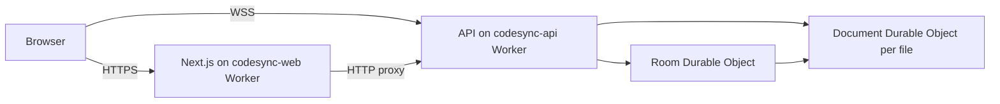

# CodeSync

CodeSync is a browser-based collaborative code editor with Monaco, Yjs CRDTs, multiplayer presence, chat, roles, waiting-room admission, WebRTC calls, and a host filesystem bridge.

The primary deployment target is **Cloudflare Workers** and does not require Redis, a database, or a continuously running home computer.

> **Important:** no hosting provider offers truly unlimited free usage. Cloudflare's free plan is suitable for light study use, but it has daily request, CPU, storage, and Durable Object quotas.

## Architecture



There are two deployable Cloudflare Workers:

- **`codesync-web`** — Next.js 15 frontend, built with OpenNext. Dynamic `/join/[key]` and `/room/[key]` pages are included.
- **`codesync-api`** — HTTP API, WebSocket gateway, room lifecycle, permissions, chat, signaling, and TURN credential generation.
  - One `RoomDurableObject` owns and serializes each room.
  - One `DocumentDurableObject` stores each room's Yjs snapshot.
  - WebSockets use the Hibernation API so idle rooms do not continuously consume CPU.

Redis, Redis Pub/Sub, Redis Lua scripts, and the legacy Node gateway are not part of the Cloudflare architecture.

## Features

- Collaborative Monaco editing with Yjs updates and per-file persistence.
- Colored cursors, selections, viewport following, chat, and reactions.
- Automatic or manual admission with a waiting room.
- Server-enforced roles, edit/speak grants, room locking, kick, and host transfer.
- One-time host credentials and short-lived, single-use reconnect credentials.
- WebRTC voice, video, screen sharing, and WebSocket signaling.
- Host filesystem bridge using the File System Access API.
- Virtual workspace when no host folder is attached.
- No external database.

## Requirements

- Node.js 20.11 or newer
- A Cloudflare account
- A GitHub account for source hosting and optional automated deployment
- A TURN service for reliable calls across restrictive networks (see [WebRTC](#webrtc-and-turn))

## Repository layout

```text
src/                    Next.js frontend, React components, editor, WebRTC client
workers/codesync/       Cloudflare API Worker and Durable Objects
scripts/                Monaco copy and Cloudflare runtime smoke test
server/                 Legacy Node/Redis backend, retained only for reference
docker/                 Legacy local Redis/coturn configuration
```

## Local development against the deployed Cloudflare backend

The recommended local workflow runs the Next.js frontend on `http://localhost:3000` and connects it to the deployed Cloudflare API and Durable Objects:

```bash
npm run dev:web
```

This mode is intended for testing UI and application changes without deploying them. The deployed backend must allow `http://localhost:3000` as an origin, which the GitHub deployment workflow configures automatically.

Local changes remain on your machine until they are reviewed, committed, and pushed. Pushing to `main` runs the GitHub Actions workflows that deploy the frontend and API Workers.

## Fully local Cloudflare development

Install both dependency trees:

```bash
npm install
npm --prefix workers/codesync install
```

Start the API Worker on port `8787`:

```bash
npm run cf:backend:dev
```

In another terminal, start the Next.js frontend on port `3000`:

```bash
npm run dev:web:local
```

`npm run dev:web:local` points the frontend at `http://localhost:8787`. The legacy `npm run dev` command starts the original Node/Redis backend instead and is documented separately below.

The legacy Node/Redis app uses only application port `3000`; its WebSocket endpoint is `ws://localhost:3000/ws`. Redis remains a required internal data service in that legacy mode.

## Legacy local Node/Redis mode

The original self-hosted stack remains available for local testing:

```bash
npm run dev
```

It serves Next.js, the WebSocket gateway at `/ws`, and the room HTTP API through the same port `3000`. Redis must be running locally. The Docker stack provides Redis and coturn together:

```bash
cp .env.example .env
# Set JWT_SECRET and TURN_SECRET in .env first.
docker compose up --build
```

Docker is a legacy/local mode, not the recommended persistent deployment. The Cloudflare Worker architecture remains the primary target.

## Validation

```bash
# Frontend and Worker static checks
npm run typecheck
npm run lint
npm run cf:build
npm run cf:backend:check
npm --prefix workers/codesync run deploy -- --dry-run

# Runtime smoke test: first run `npm run cf:backend:dev`, then:
npm run cf:runtime:smoke
```

The runtime test creates and ends its own room. It verifies:

- Room creation and lookup
- Host authentication
- Manual waiting-room admission and waiting-room broadcast privacy
- Chat delivery
- Co-host edit revocation
- File creation and Yjs convergence
- Reconnect credential reuse
- Host transfer and replacement host token
- Session termination

## Deployment to Cloudflare

### 1. Authenticate

```bash
npx wrangler login
```

### 2. Deploy the API Worker

Edit `workers/codesync/wrangler.jsonc` and replace the local/placeholder values with your production frontend origin and URL:

```text
ALLOWED_ORIGINS=https://<your-frontend-worker>
PUBLIC_APP_URL=https://<your-frontend-worker>
```

Deploy:

```bash
npm run cf:backend:deploy
```

Wrangler will print the API URL, similar to:

```text
https://codesync-api.<your-account-subdomain>.workers.dev
```

Store a TURN secret if you use HMAC-generated TURN credentials:

```bash
cd workers/codesync && npx wrangler secret put TURN_SECRET
```

The first deployment creates the Durable Object namespace and applies the SQLite migration in `workers/codesync/wrangler.jsonc`.

### 3. Configure and deploy the frontend

Edit the root `wrangler.jsonc` and replace the API placeholder:

```text
CODE_SYNC_API_ORIGIN=https://codesync-api.<your-account-subdomain>.workers.dev
```

`NEXT_PUBLIC_*` values are embedded in the browser bundle during the Next.js build. Set them before building:

```bash
NEXT_PUBLIC_API_URL=https://codesync-api.<your-account-subdomain>.workers.dev \
NEXT_PUBLIC_WS_URL=wss://codesync-api.<your-account-subdomain>.workers.dev/ws \
NEXT_PUBLIC_APP_URL=https://<your-frontend-worker> \
npm run cf:deploy
```

`NEXT_PUBLIC_API_URL` may be left empty when the frontend proxy routes should handle API requests. `NEXT_PUBLIC_WS_URL` must point to the **API Worker**, not the frontend Worker.

### 4. Update the frontend origin

After the frontend URL is known, set it in `workers/codesync/wrangler.jsonc` and redeploy the API Worker:

```bash
npm run cf:backend:deploy
```

The API checks both HTTP and WebSocket `Origin` headers. If the frontend origin is missing from `ALLOWED_ORIGINS`, browsers receive `403 FORBIDDEN`.

## GitHub and automated deployment

The API Worker is deployed automatically by
`.github/workflows/deploy-api-worker.yml` after every push to `main`. Before
pushing, configure these GitHub repository values:

- **Settings → Secrets and variables → Actions → Variables**
  - `CLOUDFLARE_ACCOUNT_ID`: your Cloudflare account ID
  - `ALLOWED_ORIGINS`: the production frontend origin, such as
    `https://codesync-web.example.workers.dev`
  - `PUBLIC_APP_URL`: the public frontend URL, without a trailing slash
- **Settings → Secrets and variables → Actions → Secrets**
  - `CLOUDFLARE_API_TOKEN`: a Cloudflare API token with permission to edit
    Workers and Durable Objects

Create the token from Cloudflare's **API Tokens** page using the **Edit
Cloudflare Workers** template, or a custom token with Workers Scripts and
Durable Objects edit permissions for the selected account. Never put the token
in a committed file or send it in chat.

Then push the repository:

```bash
git add .
git commit -m "Prepare CodeSync for Cloudflare deployment"
git branch -M main
git remote add origin https://github.com/<your-user>/<your-repo>.git
git push -u origin main
```

The first push runs the Worker type-check and deploys `codesync-api`. Later
pushes to `main` deploy it again. You can also run the workflow manually from
the repository's **Actions** tab. The workflow intentionally refuses to deploy
when the account ID, token, or production origins are missing.

For the first manual deployment, authenticate Wrangler locally and run:

```bash
cd workers/codesync
npx wrangler login
npx wrangler deploy
```

Do not commit `.env`, `.dev.vars`, Wrangler state, API tokens, or TURN secrets.
The example files contain no production secrets. The frontend deployment is a
separate workflow because its `NEXT_PUBLIC_*` values are embedded during the
Next.js build.

## Environment variables

See `.env.example` and `.dev.vars.example`. `NEXT_PUBLIC_*` values are compiled into the browser bundle, so they must be passed directly to `npm run dev:web`, `npm run build`, or the Cloudflare build command; `.dev.vars` is not a substitute for that build-time step.

| Variable                     | Used by           | Purpose                                                          |
| ---------------------------- | ----------------- | ---------------------------------------------------------------- |
| `CODE_SYNC_API_ORIGIN`       | Frontend Worker   | API Worker origin used by Next.js proxy routes                   |
| `NEXT_PUBLIC_API_URL`        | Frontend build    | Direct browser API origin; optional when using the proxy         |
| `NEXT_PUBLIC_WS_URL`         | Frontend build    | API Worker WebSocket URL; pass it directly to build/dev commands |
| `NEXT_PUBLIC_APP_URL`        | Frontend build    | Public frontend URL                                              |
| `ALLOWED_ORIGINS`            | API Worker        | Comma-separated origins allowed by CORS and WebSocket checks     |
| `PUBLIC_APP_URL`             | API Worker        | Frontend URL used to generate join links                         |
| `MAX_PARTICIPANTS`           | API Worker        | Per-room participant limit                                       |
| `ROOM_CREATE_LIMIT`          | API Worker        | Room creations allowed per browser/network identity and window   |
| `ROOM_CREATE_WINDOW_SECONDS` | API Worker        | Room-creation rate-limit window                                  |
| `STUN_SERVERS`               | API Worker        | Comma-separated STUN URLs                                        |
| `TURN_SERVER`                | API Worker        | Comma-separated TURN URLs                                        |
| `TURN_SECRET`                | API Worker secret | HMAC key for short-lived TURN credentials                        |

Do not use `ALLOWED_ORIGINS=*` in production. Room creation defaults to 30
creations per 10 minutes per browser installation and network identity. The
non-secret browser identifier is stored in `localStorage`; requests without it
fall back to the shared network quota.

## Room and permission behavior

A room is created with a `zk-` key and a one-time host token. Only the token hash is stored. In manual mode, guests wait until a host or co-host admits them. Roles and grants are checked by the Durable Object on every message; the UI is not a security boundary.

The host can transfer ownership to an admitted participant. The old host becomes a co-host, and the new host receives a replacement host token. Reconnect tokens are bound to one participant, expire after 15 minutes, and are consumed on use.

## Workspace modes

### Virtual workspace

Files and Yjs snapshots live in the room and document Durable Objects. This mode works without a host filesystem.

### Host filesystem bridge

The host uses `showDirectoryPicker()` in Chrome or Edge on desktop. The host publishes file metadata; contents are requested lazily and written back through WebSocket messages. Filesystem handles stay in the browser and are never sent to the server.

A reconnecting host may need to confirm folder access again depending on browser policy. The server keeps pending bridge requests in Durable Object state, but the active response path is in-memory and should be monitored under eviction or restart conditions.

## WebRTC and TURN

The API Worker returns ICE configuration from `/api/rtc/config`. STUN helps discover public addresses, but it cannot guarantee connectivity through every NAT or firewall. Reliable calls need a TURN relay.

Cloudflare Workers does not provide a free built-in TURN service. Use a TURN provider with a free allowance, or self-host coturn on a machine that remains online. A self-hosted service on your PC stops when the PC sleeps or loses power, so it is not a good permanent solution.

When `TURN_SECRET` is configured, the API Worker generates expiring HMAC credentials and does not expose the secret. Otherwise static `TURN_USERNAME`/`TURN_PASSWORD` credentials are returned to the browser.

## Cloudinary

Cloudinary is a media/image/video transformation service, not a suitable substitute for the API, Durable Objects, or WebSocket backend. It can optionally store uploaded images or avatars, but CodeSync does not need it for the current collaborative editor. Keep the backend on Cloudflare Workers.

## Free-tier and durability notes

- Workers Free and Durable Objects have quotas; they are not unlimited.
- A room remains available while its Durable Object and stored data are retained. Configure reasonable participant and room-creation limits.
- Durable Objects pin a room to a Cloudflare location, which can increase latency for distant collaborators.
- The API room-creation limiter is best-effort and in-memory per isolate, so it is not a globally exact abuse-control system.
- Cloudflare availability and quota behavior can change. Check the current Cloudflare pricing and limits before an important session.
- No database is required for the current feature set.

## Troubleshooting

| Symptom                           | Likely cause                                                       |
| --------------------------------- | ------------------------------------------------------------------ |
| Room creation returns `403`       | Frontend origin is missing from API `ALLOWED_ORIGINS`              |
| WebSocket returns `400`           | URL is missing a valid `?room=zk-...` query                        |
| Browser uses the wrong WebSocket  | `NEXT_PUBLIC_WS_URL` points at the frontend instead of API Worker  |
| Frontend proxy returns `503`      | `CODE_SYNC_API_ORIGIN` is missing or the API Worker is unreachable |
| Peers connect but media fails     | TURN is missing or unreachable; STUN alone is not equivalent       |
| Host folder button is unavailable | Browser does not support the File System Access API                |
| Monaco never loads                | Run `node scripts/copy-monaco.mjs` and rebuild                     |

## License

Private project — all rights reserved.
